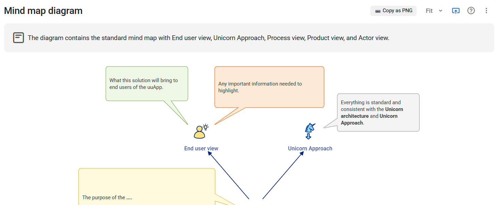
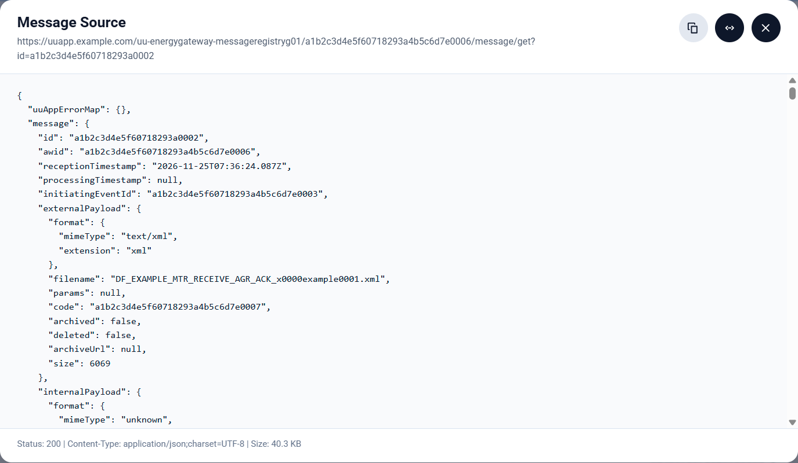
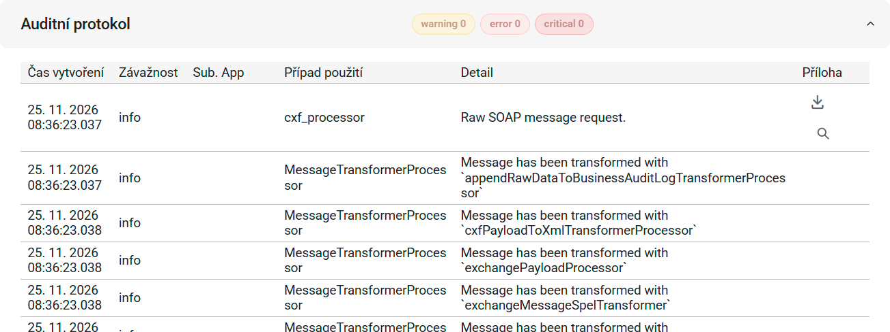
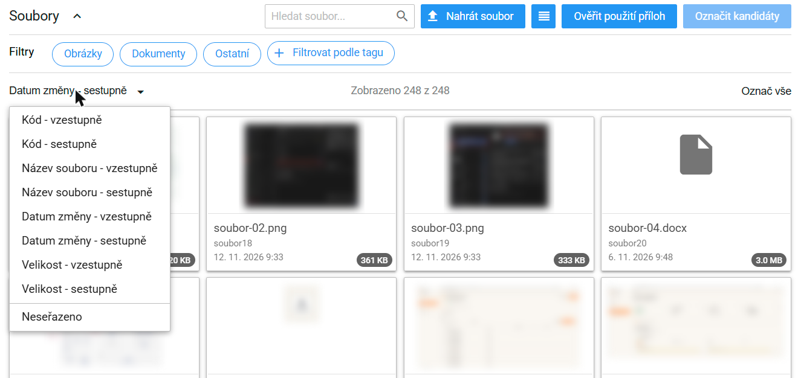
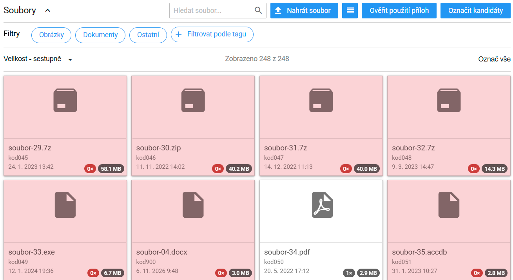
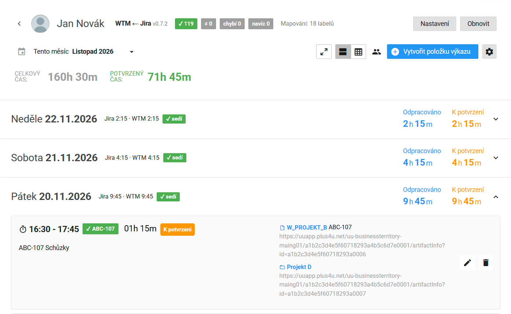
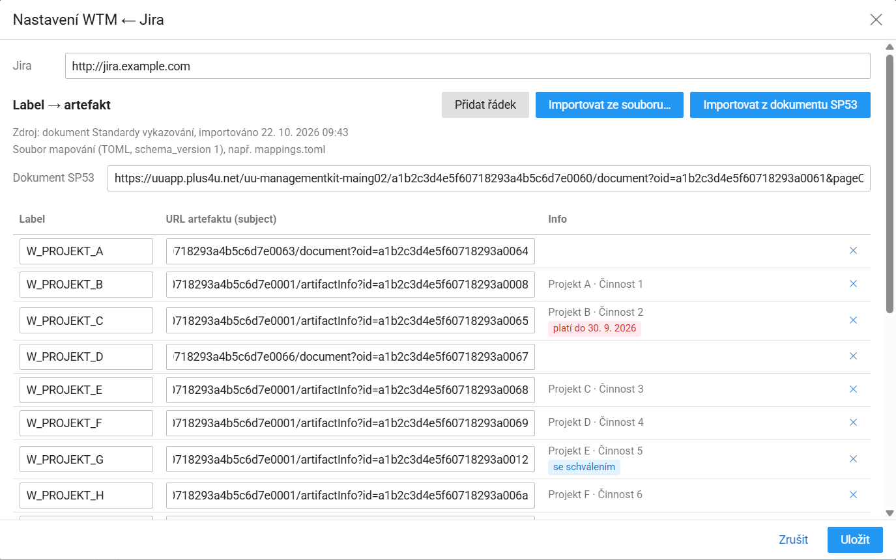

# GreaseMonkey scripts

Small Tampermonkey helpers I use every day — Cursor usage KPIs, BookKit fulltext search, Message Registry previews, uuIdentity login fixes, and more.

Want to try them? Use at your own risk.

**Disclaimer** — these scripts are usually generated with ChatGPT and tested only for my personal purposes.

## What's new

- **2026-10-16 · uuBookKit Fulltext Search 1.9–1.11** – books are indexed automatically on your first visit and an outdated index is refreshed in the background, reloading only changed pages. Pages you open from the search rank higher next time (★ N×). The ☰ book menu spins and shows progress while indexing. [Details](changelogs.md#bookkit-fulltext-searchuserjs)
- **2026-10-16 · IndSoft JIRA - Attachment preview 1.0–1.2.3** (new) – opens HTML, text, image and PDF attachments in a new tab with its own shareable address; HTML attachments work as live dashboards. Also on Unicorn and ČEPS Jira. [Details](changelogs.md#jira-attachment-previewuserjs)
- **2026-10-15 · WTM ← Jira sync 0.6** – import of the label mapping from the SP53 document, „Zapsat vše“ for the whole month. [Details](changelogs.md#wtm-jira-syncuserjs)

Full history of every script: **[changelogs.md](changelogs.md)**

## Installation

<b>How to install</b> – Tampermonkey in Chrome, install links, import from URL

**New to Chrome + Tampermonkey?** Read the short Czech setup guide first:

**[Jak nainstalovat Tampermonkey v Chrome →](HOW-TO-INSTALL-TAMPERMONKEY.md)**

Click an **Install** link below. Tampermonkey should open the install or update prompt directly.

If direct install is blocked by the browser, use the same URL in the addon page:

- Settings (Nastaveni)
- Import from URL

## Addons

<table>
<thead>
<tr><th align="left">Addon</th><th align="left">Address</th></tr>
</thead>
<tbody>
<tr>
<td>

<b>Copy uuBml as PNG to clipboard</b> – copy a uuBml diagram as an image

 
Adds a <b>📷 Copy as PNG</b> button to the header of every uuBml diagram on <code>uuapp.plus4u.net</code> pages – BookKit, ManagementKit and other uuApps. One click renders the diagram in its full size, including the page styles, into a PNG and puts it into the clipboard, ready to paste into Teams, Outlook, Word or a Jira comment. A green notice confirms the copy, a red one reports an error.

 Copy as PNG button in the diagram header

</td>
<td valign="top"><a href="https://raw.githubusercontent.com/indsoft/GreaseMonkey/refs/heads/main/uubml-copy-as-png.user.js">Install</a></td>
</tr>
<tr>
<td>Cursor Usage Statistics</td>
<td valign="top"><a href="https://raw.githubusercontent.com/indsoft/GreaseMonkey/refs/heads/main/cursor-usage-statistics.user.js">Install</a></td>
</tr>
<tr>
<td>

<b>uuBookKit Fulltext Search</b> – fulltext search across BookKit books

 
Works in <code>uu-bookkit-maing01</code> books where the built-in search is too limited. The script keeps its own fulltext index of book pages and sections in the browser, remembers the books you visit and searches one book or all indexed books from one dialog (<b>Fulltext</b> button in the book header).
<ul>
<li><b>Automatic indexing</b> – a book without an index is indexed in the background on your first visit. An outdated index is refreshed on the next visit and only new and changed pages are loaded again; the whole book is reloaded once a day.</li>
<li><b>Preferred results</b> – pages you open from the search rank higher next time and are marked <b>★ N×</b>. The × in the badge resets one page, <b>Vynulovat oblíbenost</b> in the book management resets all.</li>
<li><b>Book menu ☰</b> – switch between known books; while indexing, the icon spins and the menu shows progress.</li>
<li><b>Book management</b> (⚙ in the menu) – refresh or remove an index, export and import the book list, turn automatic indexing off.</li>
</ul>

 Search in the current book – the page opened before is preferred (★ 1×)

 Book menu while a book is being indexed

 Book management

</td>
<td valign="top"><a href="https://raw.githubusercontent.com/indsoft/GreaseMonkey/refs/heads/main/bookkit-fulltext-search.user.js">Install</a></td>
</tr>
<tr>
<td>

<b>Autoclose authentication page</b> – close the leftover uuIdentity tab after login

 
After signing in to Plus4U from a CLI, a desktop app or an MCP server, uuIdentity leaves a tab with the authorization code and the text <i>Uzavřete prosím tuto stránku</i> (“Please close this page”). The script waits for this text and closes the tab by itself. It runs only on the <code>showAuthorizationCode</code> page and recognizes the Czech text. There is nothing to see – the tab just disappears.

</td>
<td valign="top"><a href="https://raw.githubusercontent.com/indsoft/GreaseMonkey/refs/heads/main/close-auth-page.user.js">Install</a></td>
</tr>
<tr>
<td>

<b>Identity login password manager bridge</b> – let password managers fill the uuIdentity login

 
The uuIdentity login form uses two fields named <code>accessCode1</code> / <code>accessCode2</code>, which password managers (Chrome, Bitwarden, 1Password, KeePass…) do not recognize as a user name and password. The script lays two ordinary <b>Jméno</b> / <b>Heslo</b> fields (<code>autocomplete="username"</code> / <code>current-password</code>) over the original ones and copies everything you type or the password manager fills into the original form, so the login itself works as before. The eye button still shows or hides both values. Works on every uuIdentity login page (<code>…/uu-identitymanagement-maing01/…/login</code>), including customer instances.

</td>
<td valign="top"><a href="https://raw.githubusercontent.com/indsoft/GreaseMonkey/refs/heads/main/identity-login-password-manager.user.js">Install</a></td>
</tr>
<tr>
<td>JSONATA JAVA Checker</td>
<td valign="top"><a href="https://raw.githubusercontent.com/indsoft/GreaseMonkey/refs/heads/main/jsonata-java-checker.user.js">Install</a></td>
</tr>
<tr>
<td>IndSoft JIRA - ManiTime copy tag</td>
<td valign="top"><a href="https://raw.githubusercontent.com/indsoft/GreaseMonkey/refs/heads/main/indsoft-jira-manictime.user.js">Install</a></td>
</tr>
<tr>
<td>

<b>IndSoft JIRA - Attachment preview</b> – open Jira attachments in a new tab

 
Adds an eye button <b>Náhled</b> to attachments on IndSoft, Unicorn (<code>jira.unicorn.com</code>) and ČEPS (<code>jira-dc.ceps.cz</code>) Jira issues – in the corner of the tile in the thumbnail view, next to the file name in the list view. Clicking the file name still downloads it.
<ul>
<li><b>Formats</b> – HTML, text (txt, log, csv, sql, xml, json, yaml, md, jsonata, scripts…; JSON is formatted), images including SVG and PDF, up to 10 MB.</li>
<li><b>Own address</b> – the preview tab is <code>…/browse/&lt;issue&gt;?viewAttachment=&lt;file name&gt;</code>, so it can be reloaded and shared, and it always shows the newest upload of that name. Back returns to the issue.</li>
<li><b>Live dashboards</b> – an open preview checks for a newer upload every 30 s while visible and redraws itself.</li>
<li><b>Safe HTML</b> – HTML runs in a sandboxed frame without access to Jira or your login; scripts from a CDN (e.g. D3) are fetched and inlined, because Unicorn Jira's CSP also applies to that frame.</li>
</ul>

 Eye button on the attachment tiles

 Preview tab with its own address – an HTML dashboard rendered by its script

 JSON attachment, formatted

</td>
<td valign="top"><a href="https://raw.githubusercontent.com/indsoft/GreaseMonkey/refs/heads/main/jira-attachment-preview.user.js">Install</a></td>
</tr>
<tr>
<td>

<b>Message Registry - Auto refresh</b> – reload the message list periodically

 
Adds an <b>autorefresh</b> checkbox with an interval in seconds (1–3600, default 10) next to the toolbar of the message list. While it is on, the script clicks the native <b>Obnovit data</b> / <b>Reload Data</b> button at that interval; the line under the control shows the time to the next reload. The setting is remembered for each page address. Works in <code>uu-energygateway-messageregistryg01</code> and in the AFLEX data flows (<code>usy-edcaflex-maing01</code>).

 Autorefresh control in the list toolbar

</td>
<td valign="top"><a href="https://raw.githubusercontent.com/indsoft/GreaseMonkey/refs/heads/main/message-registry-autorefresh.user.js">Install</a></td>
</tr>
<tr>
<td>

<b>Message Registry - Preview downloads</b> – show payloads and attachments instead of downloading them

 
For the standard <code>uu-energygateway-messageregistryg01</code> UI (uuCloud g02) and the AFLEX data flows. In the message detail it adds preview buttons 🔍 next to the download buttons and opens the content in a dialog instead of a downloaded file.
<ul>
<li><b>Payloads and attachments</b> – internal and external payload and every attachment in the audit log; the native download buttons keep working.</li>
<li><b>Message source</b> (<code>&lt;&gt;</code>) – the whole message as returned by <code>message/get</code>, also for messages without an internal payload.</li>
<li><b>Dialog tools</b> – JSON and XML syntax highlighting, a format / raw content switch (an HTTP status line is kept apart from the body), copy and download.</li>
<li><b>Audit log</b> – a summary of warning / error / critical entries in the section header (click jumps to the first one), coloured severities and row hover.</li>
<li><b>Links</b> – an icon opens a linked message in a new window; in a modal the script uses the message you clicked, not the one in the address.</li>
</ul>

 Message source in the preview dialog (anonymized)

 Audit log with severity summary and attachment preview

</td>
<td valign="top"><a href="https://raw.githubusercontent.com/indsoft/GreaseMonkey/refs/heads/main/message-registry-preview-downloads.user.js">Install</a></td>
</tr>
<tr>
<td>

<b>Message Registry - Preview downloads (UUCloud1)</b> – the same previews for IDS Apps

 
Variant of <b>Message Registry - Preview downloads</b> for <code>usy-idsmari-messageregistryg01</code> (IDS Apps, uuCloud g01). It has the same preview dialogs and formatting tools, plus fixes for the older UU5 rendering, the placement of attachment buttons and authenticated preview requests. It looks the same as the screenshots above. Install only the variant that matches your application.

</td>
<td valign="top"><a href="https://raw.githubusercontent.com/indsoft/GreaseMonkey/refs/heads/main/message-registry-preview-downloads.uucloud1.user.js">Install</a></td>
</tr>
<tr>
<td>

<b>uuBookKit – FileManager</b> – file sizes, sort by size, find unused attachments

 
Extends the File Manager of a BookKit book (<b>Kniha → Správce souborů</b>).
<ul>
<li><b>Sizes</b> – every tile shows the file size in its corner.</li>
<li><b>Sort by size</b> – the native sort menu gets <b>Velikost – vzestupně / sestupně</b> (size ascending / descending), so the largest files are easy to find.</li>
<li><b>Ověřit použití příloh</b> (check attachment usage) – reads all pages of the book and shows on each tile how many times the file is referenced (<b>N×</b>). Files without a reference (<b>0×</b>) turn red. The check only reads the book.</li>
<li><b>Označit kandidáty</b> (select candidates) – after a check without errors, adds the unused files to the native selection for bulk actions, e.g. deleting.</li>
</ul>
The check is a heuristic: it may miss non-standard references (another book, an external link). When a page fails to load, no file is marked as unused and the selection stays disabled. Based on FileManager 1.4.0 by Lukáš Vyleťal.

 Size on the tiles and sorting by size

 After the usage check – unused files are red (0×)

</td>
<td valign="top"><a href="https://raw.githubusercontent.com/indsoft/GreaseMonkey/refs/heads/main/bookkit-file-manager.user.js">Install</a></td>
</tr>
<tr>
<td>

<b>WTM ← Jira sync</b> – fill WTM timesheets from your Jira worklogs

 
On the WTM page <b>Výkazy za měsíc</b> (monthly timesheet) the script pairs WTM items with your worklogs in IndSoft Jira (<code>jira.indsoft.local</code>). Jira is the source of truth: the script never writes to Jira and never deletes anything in WTM. You need to be signed in to Jira in the same browser.
<ul>
<li><b>Bar in the timesheet header</b> – counts of matching (✓), different (≠), missing and extra items, the label mapping, <b>Nastavení</b> (settings), <b>Obnovit</b> (reload) and <b>Zapsat vše</b> for the whole month.</li>
<li><b>Day and item marks</b> – green = matches Jira, orange = differs (<b>Upravit podle Jiry</b> fixes it), a virtual row = missing in WTM (<b>Zapsat do WTM</b>, <b>Zapsat vše</b> for the day), red = extra in WTM (delete it by hand). Holidays and other absences filled in by WTM are marked grey.</li>
<li><b>Label → artifact</b> – the WTM artifact comes from the ticket's <code>W_</code> label. The table in the settings can be imported from <code>mappings.toml</code> (<code>schema_version = 1</code>; <code>label</code>, <code>subject_url</code>, optional <code>valid_to</code>, <code>blocked</code>, <code>note</code>, <code>project</code>, <code>artifact</code>) or straight from the ManagementKit document <i>SP53 Standardy vykazování</i>. An expired or blocked label stops the write with a reason.</li>
<li><b>Forgotten worklogs</b> – days older than 7 days, which WTM no longer accepts, can be written as a replacement on a weekend (or free time on working days) of the same month; the original day and time go into the description and you confirm the list first.</li>
</ul>

 Monthly timesheet – every day and item matches Jira

 Settings – label → artifact mapping imported from the SP53 document

</td>
<td valign="top"><a href="https://raw.githubusercontent.com/indsoft/GreaseMonkey/refs/heads/main/wtm-jira-sync.user.js">Install</a></td>
</tr>
</tbody>
</table>

Rows with ▸ expand to a description and screenshots.

## Notes

Use `Cursor Usage Statistics` on the Cursor usage dashboard to see spend KPIs (today, last 7 days, calendar month, daily average), a stacked chart of the top five models by spend plus others, and a per-model cost table. Toggle the chart between 7 or 30 days and tokens or spend; click a model in the table to filter it in the chart. Tooltips show daily and per-segment details. Included usage remains visible in token totals but counts as $0 spend, matching Cursor's own table.

## Changelog

Per-script version history: **[changelogs.md](changelogs.md)**

Repo milestones (legacy):

- 1.0 - initial version
- 1.1 - fix of block element text
- 1.2 - add message detail download preview userscript
- 1.3 - add preview format button for JSON and XML payloads
- 1.4 - add message registry auto refresh userscript
- 1.5 - add UUCloud1-specific message registry preview downloads variant
- 1.6 - add uuIdentity login password manager bridge
- 1.7 - add uuBookKit fulltext search userscript
- 1.8 - add uuBookKit FileManager userscript (sizes, sort, heuristic usage check)
